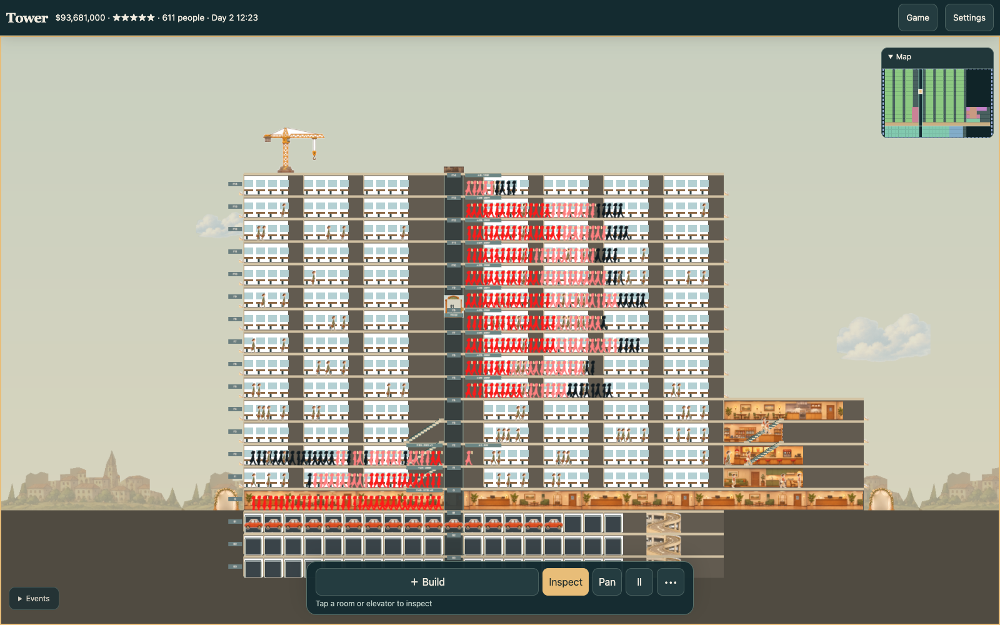

# ConciliaTower

A tower-building simulation with a C/WebAssembly core, a Three.js browser view
and a native SDL2 frontend.
Based on [ConciliaTower by Jonahss](https://github.com/Jonahss/concilia-tower),
the original C/SDL browser port.
Build offices, homes, hotels and transport, manage tenants and finances, and
advance through the star ratings. Sandbox mode unlocks every building.



Play at [tower.sergeybaus.com](https://tower.sergeybaus.com).

## Browser

Requires [Emscripten](https://emscripten.org/docs/getting_started/downloads.html)
Bun, Python 3 and uv. From the repository root:

```sh
bun install --frozen-lockfile
make web
python3 -m http.server 8611 --directory web/dist
```

Open <http://localhost:8611>. Graphics and sound are bundled; choose **New tower**
or **Play** to start. Check **Sandbox** to start a new tower with all buildings
unlocked.

**Settings** switches four complete gameplay styles in the current tower:
architectural schematic, modern pixel art, warm dollhouse and stylized 3D
miniature. Camera zoom and interface size are independent. The responsive
browser controls support touch construction, pan, inspection and zoom.

Install from Settings for standalone play on a phone. On iPhone/iPad, use
Safari's **Share → Add to Home Screen → Open as Web App**; a page cannot hide
Safari's toolbar itself. Progress and settings are local to this browser and
origin. A completed save message means the IndexedDB sync finished; export a
backup for a copy outside browser storage. See [mobile play](docs/mobile.md).

The game uses the [Three.js browser presentation](docs/three-renderer.md):
source-resolution art, smooth DPR rendering, shallow geometry and camera parallax,
DOM menus/panels and Web Audio synthesis. Native SDL remains available.
The site integration pipeline publishes the game together with its landing page.

Saves stay in this browser. The title screen lets you rename, duplicate, delete,
import and download towers. Import `.sav` browser backups or SimTower 1.1
`.TDT` / `.TWR` files; export `.sav` backups or `.TDT` files. Use `.TDT` to move
towers between native and browser builds.

## Native

Requires a C11 compiler, `make`, `pkg-config`, SDL2 and SDL2_ttf development
libraries. On Debian or Raspberry Pi OS:

```sh
sudo apt install build-essential pkg-config libsdl2-dev libsdl2-ttf-dev
make
./simtower
```

Run from the repository root so the game can find `data/tower.dat`. To open
an existing tower:

```sh
./simtower mytower.tdt
```

## Controls

- Mouse: select tools and place buildings; use the menus for game actions.
- Arrow keys: scroll the tower.
- Space: pause or resume; `+` / `-`: change simulation speed.
- F5 or Ctrl/Cmd+S: save; F9: load.
- F6: export `.TDT`; F7: financial report; F8: toggle campaign/sandbox.
- Browser toolbar: Pan, Build, Use, Inspect, Bulldoze, pause/speed and Save.
- Settings: live style, camera zoom, interface size, fullscreen, install and exports.

## Resources and provenance

The game ships its own graphics and synthesized sounds in `data/tower.dat`.
It does not require an original executable. Resource sources, generation details
and regeneration instructions are documented in [the art provenance](data/art/PROVENANCE.md)
and [the audio provenance](data/RESOURCE-AUDIO.md).
The new splash is documented in [its provenance](web/art/splash-provenance.json).
The four complete style packs and source mappings are documented in
[style packs](docs/style-packs.md). Existing source sheets retain their historical model-routing metadata.
The Three.js migration uses only deterministic crops of those existing sources;
it makes no image-generation requests.

The simulation reimplements SimTower mechanics in C. Historical research notes
remain in [docs/](docs/), including
[original-game bugs](docs/ORIGINAL-BUGS.md) and
[OpenSkyscraper differences](docs/OPENSKYSCRAPER-ERRATA.md).
SimTower belongs to its respective rights holders; this project is not affiliated
with or endorsed by them.
