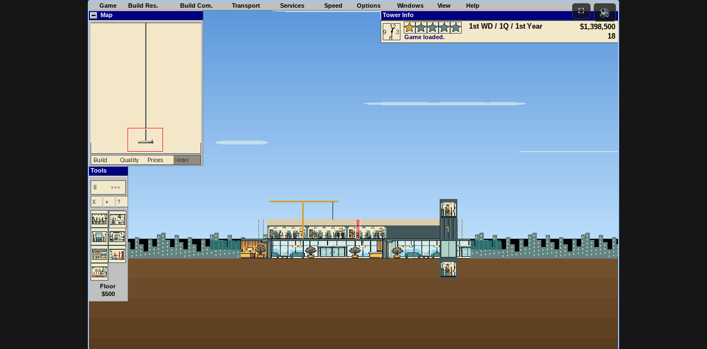

# ConciliaTower

A tower-building simulation in C and SDL2, with a WebAssembly browser build.
Build offices, homes, hotels and transport, manage tenants and finances, and
advance through the star ratings. Sandbox mode unlocks every building.



## Browser

Requires [Emscripten](https://emscripten.org/docs/getting_started/downloads.html)
and Python 3. From the repository root:

```sh
make web
python3 -m http.server 8611 --directory web/dist
```

Open <http://localhost:8611>. Graphics and sound are bundled; choose **New tower**
or **Play** to start. Check **Sandbox** to start a new tower with all buildings
unlocked.

The **Эксперименты** button opens the experiment menu over the current session.
Switch visual proposals and read architecture concepts in place, then return to
the game. These are prototypes and unapproved designs, not alternate engines.
See [the discussion brief](docs/experiments/README.md).

Saves stay in this browser. The title screen lets you rename, duplicate, delete,
import and download towers. Import `.sav` browser backups or SimTower 1.1
`.TDT` / `.TWR` files; export `.sav` backups or `.TDT` files. Use `.TDT` to move
towers between native and browser builds.

## Native

Requires a C11 compiler, `make`, `pkg-config`, SDL2 and SDL2_ttf development
libraries. On Debian or Raspberry Pi OS:

```sh
sudo apt install build-essential pkg-config libsdl2-dev libsdl2-ttf-dev
make
./simtower
```

Run from the repository root so the game can find `data/tower.dat`. To open
an existing tower:

```sh
./simtower mytower.tdt
```

## Controls

- Mouse: select tools and place buildings; use the menus for game actions.
- Arrow keys: scroll the tower.
- Space: pause or resume; `+` / `-`: change simulation speed.
- F5 or Ctrl/Cmd+S: save; F9: load.
- F6: export `.TDT`; F7: financial report; F8: toggle campaign/sandbox.
- Browser buttons: fullscreen and mute.

## Resources and provenance

The game ships its own graphics and synthesized sounds in `data/tower.dat`.
It does not require an original executable. Resource sources, generation details
and regeneration instructions are documented in [the art provenance](data/art/PROVENANCE.md)
and [the audio provenance](data/RESOURCE-AUDIO.md).
The browser landing illustration is documented in [web/art/README.md](web/art/README.md).

The simulation reimplements SimTower mechanics in C. Historical research notes
remain in [docs/](docs/), including
[original-game bugs](docs/ORIGINAL-BUGS.md) and
[OpenSkyscraper differences](docs/OPENSKYSCRAPER-ERRATA.md).
SimTower belongs to its respective rights holders; this project is not affiliated
with or endorsed by them.
