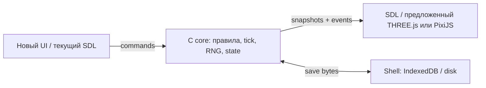

# Tower: четыре исследования для обсуждения

**Архитектурные варианты UNAPPROVED.** Реализовано только экранное меню сравнения; движок и механики не менялись. Исследования выполнены параллельно на базе `8d1f452`.

**Одна рекомендуемая траектория для нового UI/3D:** выделить C/Wasm core → DOM UI + выбранный renderer (THREE.js при намерении перейти к объёму, PixiJS для чистого 2D). SDL HiDPI/zoom — отдельная короткая альтернатива, если сохраняем текущий UI; полная модернизация SDL UI не является предварительным этапом нового интерфейса.

## 1. Визуальный язык

Четыре сцены 1536×1024 с одним смысловым планом: фронтальный разрез, четыре этажа, центральный лифт, одинаковые типы помещений. Независимая генерация сохраняет композицию приблизительно, не пиксель в пиксель.

| Направление | Сравнение | Сильная сторона / цена |
|---|---|---|
| Схема | [Изображение](../../web/experiments/assets/style-schematic.png) | Читаемый обзор; нужна строгая сетка и чистка линий |
| Pixel art | [Изображение](../../web/experiments/assets/style-modern-pixel.png) | Ближе нынешнему sprite pipeline; единая пиксельная сетка потребует ручной фиксации |
| Тёплый дом | [Изображение](../../web/experiments/assets/style-warm-dollhouse.png) | Уют и характер помещений; детали теряются вдали |
| 3D-миниатюра | [Изображение](../../web/experiments/assets/style-miniature-3d.png) | Объёмные силуэты; настоящий 3D потребует моделей и production pipeline |

Победитель не выбран. Полный [разбор стилей](styles.md) отделяет концепт от готовых игровых ресурсов. Уменьшение в меню до 384 px помогает сравнить обзор, но не доказывает читаемость интерьера на нынешних 24 px.

Все пять исходных PNG созданы через явный `openai/gpt-image-2.6-flare`; ответы Gateway подтверждают canonicalSlug, provider OpenAI и единственную успешную попытку без fallback. [Provenance](../../web/experiments/assets/provenance.json) содержит точные промпты, параметры, routing metadata, generation IDs и SHA-256. [GIF дверей](../../web/experiments/assets/elevator-loop.gif) собран Pillow из шести ячеек [сгенерированного листа](../../web/experiments/assets/elevator-loop-sheet.png), 180 ms/кадр. Это не native animated output. Небольшое дрожание геометрии требует чистки; движку нужен атлас кадров, GIF здесь демонстрационный.

## 2. Современное разрешение и UI

Альтернативный короткий путь, если остаёмся на текущем UI: сохранить C/SDL2, согласовать CSS/буфер/DPR и координаты кликов; при необходимости разделить viewport/zoom мира и масштаб UI. Большой экран должен давать больше видимой башни, а Retina — более чёткий текст. Нынешний `game.zoom` не является готовой функцией. Для нового UI основной путь — C/Wasm core → DOM + выбранный renderer; предварительно переделывать весь SDL UI не требуется. Масштабирование старых спрайтов не добавит деталей. [Символы, этапы и первичные SDL/Emscripten/W3C источники](modernize.md).

## 3. Современный renderer и путь в 3D

Для реального объёмного будущего — **THREE.js + ортографическая камера + C/WASM core**. Начать с плоских текстур и постепенно заменять помещения геометрией. Если игра останется двумерным разрезом — **PixiJS** проще соответствует нынешним спрайтам. Оба требуют нового контракта view/commands; заменить один указатель renderer недостаточно. Ускоренный SDL уже используется в браузере. FPS, память и размеры загрузки не измерены. [Сравнение, реальные швы и официальные docs](renderer.md).

## 4. Вся логика отдельно от UI

Реалистичен постепенный C core, а не немедленная перепись. `game.c/people.c/tower.c` уже имеют headless основу; в `main.c` ещё живут unlock, стоимость кабин, post-build effects, массовые цены и мутации расписаний. Изоляции мешают globals/statics, общий RNG, presentation hooks и raw-struct `.sav`.

Будущая граница: **commands → tick → snapshots/events + save bytes**, с явной rules/content revision и владением RNG. Сначала перенести правила за команды, вызываемые старым UI; затем убрать скрытое состояние и подключить новый view. Переносимый save и новые механики — отдельные решения. [Карта зависимостей, контракт и концепция UI-free проверок](core.md).

Стрелки описывают целевую границу, пока не реализованную.

## Решения Сергея

1. Какое направление развивать? **Рекомендуемый следующий шаг:** выбрать одну из четырёх сцен, затем подготовить одну комнату и человека в реальном игровом масштабе; полный пак пока не генерировать.
2. Нужна ли настоящая 3D-геометрия? **Default:** пока сохранить фронтальный разрез; при твёрдом выборе объёма — THREE.js, при чистом 2D — PixiJS. Художественная 3D-стилизация сама по себе не требует 3D engine.
3. С чего начинать техническую работу после обсуждения? **Default:** C/Wasm core → DOM UI + выбранный renderer, сохраняя текущие механики при выделении границы. SDL HiDPI/zoom выбирать как альтернативу при сохранении старого UI. Полную перепись не начинать.
4. Насколько важна точность продолжения старых saves/RNG? **Default:** сохранить текущий рабочий путь и отдельно согласовать новый переносимый формат и изменения случайной последовательности перед переключением.

## Статус после уточнения задачи

Эти документы остаются исследованиями для отдельных обсуждений. Концепции renderer/core не являются пунктами игрового меню и не разрешают их реализацию. Реализованные варианты получают настройки в текущей игре; модернизация текущего engine/UI и четыре полных игровых стиля одобрены отдельно. Актуальное поведение описано в [mobile play](../mobile.md) и [style packs](../style-packs.md).
