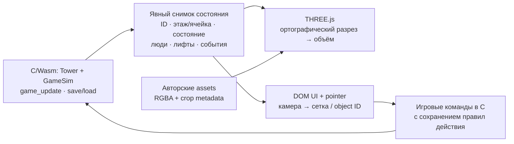

# Renderer: THREE.js или PixiJS

**UNAPPROVED — концепция для обсуждения, не решение о миграции.** Исследование 2026-11-08; кодовая база `8d1f4522d53e57ad781164c1f0d7f2dbe3897227`. В рамках исследования создан только этот документ; движок, сборки и работающий сервер не затронуты.

## Коротко для общего обзора

Рекомендация при сохранении перспективы 3D: **THREE.js, ортографическая камера, существующая C/Wasm-симуляция**. Начать можно с плоских текстурированных помещений, затем заменить их объёмной геометрией в той же сцене. Если продукт остаётся двумерным разрезом, **PixiJS — более прямое соответствие текущим спрайтам и взаимодействиям**. Оба варианта требуют границы между симуляцией и представлением: готового renderer API сейчас нет. Выигрыш в скорости не измерен; новый renderer сам по себе не увеличит детализацию ресурсов.

## Где проходит граница в текущем коде

Ссылки закреплены за исследованным commit, номера относятся к нему.

| Шов | Реальный код | Следствие для нового представления |
|---|---|---|
| Модель мира | [`TowerCell`, `Tenant`, `Tower`](https://github.com/neoromantic/tower/blob/8d1f4522d53e57ad781164c1f0d7f2dbe3897227/src/tower.h#L208): клетка с `tenant_id`; помещение с `floor/x/width/height`; сетка и экономика в `Tower` | Передавать идентичность и состояние помещений, а не инструкции SDL. Размер клетки сейчас 8×36; сетка — 375 колонок, этажи −10…105 ([константы](https://github.com/neoromantic/tower/blob/8d1f4522d53e57ad781164c1f0d7f2dbe3897227/src/tower.h#L16)). |
| Симуляция | [`game_update`](https://github.com/neoromantic/tower/blob/8d1f4522d53e57ad781164c1f0d7f2dbe3897227/src/game.c#L1619), [`GameSim`/save API](https://github.com/neoromantic/tower/blob/8d1f4522d53e57ad781164c1f0d7f2dbe3897227/src/game.h#L810) | C сохраняет время, людей, транспорт, деньги и сохранения. Это уже C-реализация восстановленных механик, не исполнение старого EXE. Отделение от SDL не означает полную независимость: в `game.c` остаются звуковые вызовы и web hooks. |
| Владение состоянием | [`game`](https://github.com/neoromantic/tower/blob/8d1f4522d53e57ad781164c1f0d7f2dbe3897227/src/main.c#L343) объединяет `Tower`, `GameSim`, SDL, окна, камеру и инструменты | Нельзя заменить один указатель `renderer` на JS-библиотеку. Нужен небольшой явный контракт чтения состояния и игровых команд. |
| Камера и координаты | [`screen_to_grid` / `grid_to_screen`](https://github.com/neoromantic/tower/blob/8d1f4522d53e57ad781164c1f0d7f2dbe3897227/src/main.c#L827), [`clamp_camera`](https://github.com/neoromantic/tower/blob/8d1f4522d53e57ad781164c1f0d7f2dbe3897227/src/main.c#L960) | Сейчас `world_x=cell×8`, `world_y=−floor×36`; камера задаёт центр. Для THREE.js удобно выбрать Y вверх: `y=floor×36`, явно учесть верхнюю границу спрайта. Обратное преобразование должно сохранить выбор этажа, в том числе подземного. |
| Слои и визуальное состояние | [`render`](https://github.com/neoromantic/tower/blob/8d1f4522d53e57ad781164c1f0d7f2dbe3897227/src/main.c#L8255), [`render_tower`](https://github.com/neoromantic/tower/blob/8d1f4522d53e57ad781164c1f0d7f2dbe3897227/src/main.c#L1412) | Небо → этажи/помещения/жители → транспорт/люди → события → ghost → UI/модальные окна. Renderer вычисляет, например, `condo_lit` по людям; снимок одних клеток потеряет ночное освещение. |
| Анимация | [`render_occupants`](https://github.com/neoromantic/tower/blob/8d1f4522d53e57ad781164c1f0d7f2dbe3897227/src/main.c#L3611), [интерполяция кабин](https://github.com/neoromantic/tower/blob/8d1f4522d53e57ad781164c1f0d7f2dbe3897227/src/main.c#L3786) | Кадры жителей хранятся в `GameSim.occupants`; плавное положение кабин — локальная история renderer. JS должен сохранить различие между истинным состоянием и интерполяцией. |
| Действия | [`handle_event`](https://github.com/neoromantic/tower/blob/8d1f4522d53e57ad781164c1f0d7f2dbe3897227/src/main.c#L9102), [`drag_place_units`](https://github.com/neoromantic/tower/blob/8d1f4522d53e57ad781164c1f0d7f2dbe3897227/src/main.c#L8406), [`demolish_click_grid`](https://github.com/neoromantic/tower/blob/8d1f4522d53e57ad781164c1f0d7f2dbe3897227/src/main.c#L6384) | Строительство включает unlock, выбор высоты lobby, drag, звук и `game_notify_built`; снос имеет приоритет лифтов и подтверждения. Прямой вызов `tower_place`/`tower_remove` из JS обойдёт часть поведения. |
| Текстуры | [`Sprite`](https://github.com/neoromantic/tower/blob/8d1f4522d53e57ad781164c1f0d7f2dbe3897227/src/sprites.h#L16), [`sprites_init`](https://github.com/neoromantic/tower/blob/8d1f4522d53e57ad781164c1f0d7f2dbe3897227/src/sprites.c#L118), [palette/key/composition](https://github.com/neoromantic/tower/blob/8d1f4522d53e57ad781164c1f0d7f2dbe3897227/src/sprites.c#L228) | `SpriteAtlas` хранит отдельные `SDL_Texture`, а не готовую JS spritesheet. Нужно сохранить crop, alpha keys, составные лестницы/кино и циклические палитры при подготовке браузерных изображений. |

Браузер уже запрашивает `SDL_RENDERER_ACCELERATED` ([инициализация](https://github.com/neoromantic/tower/blob/8d1f4522d53e57ad781164c1f0d7f2dbe3897227/src/main.c#L10032)). Обещать ускорение просто за счёт «перехода на GPU» было бы неверно.

## Сравнение для Tower

| Критерий | THREE.js | PixiJS |
|---|---|---|
| Двумерный разрез | `OrthographicCamera` сохраняет размер независимо от глубины; помещения можно представить плоскостями с текстурами. Нужно явно решить слои, прозрачность и материалы. [Камера](https://threejs.org/docs/pages/OrthographicCamera.html). | `Container`/`Sprite`, текстуры и их прямоугольные области ближе к текущему SDL-подходу. [Textures](https://pixijs.com/8.x/guides/components/textures). |
| Масштабирование | `camera.zoom`; размер render buffer задаётся отдельно от CSS. Новая камера не создаёт новых деталей в старом bitmap. [Камера](https://threejs.org/docs/pages/OrthographicCamera.html), [renderer](https://threejs.org/docs/pages/WebGLRenderer.html). | Масштаб контейнера мира; `resolution`/`autoDensity` отделяют плотность пикселей canvas от CSS. [Application](https://pixijs.com/8.x/guides/components/application). |
| Путь в 3D | Геометрия комнат, освещение и камера живут в той же 3D-сцене. Плоские помещения можно заменять по одному; повторяющиеся элементы допускают instancing. [InstancedMesh](https://threejs.org/docs/pages/InstancedMesh.html). | Основа — 2D. Для полноценного объёма понадобится другой renderer или отдельная 3D-интеграция; считать её бесплатным следующим шагом нельзя. Текущая [архитектура](https://pixijs.com/8.x/guides/concepts/architecture). |
| Выбор объектов | `Raycaster`; hit переводится в ID помещения/кабины. Для плоского строительства достаточно обратного преобразования камеры в сетку. [Raycaster](https://threejs.org/docs/pages/Raycaster.html). | DOM-подобные pointer events, `eventMode`, `hitArea`. В v8 обычный `pointermove` привязан к попаданию в объект; drag по пустому миру требует соответствующего обработчика. [Events](https://pixijs.com/8.x/guides/components/events). |
| Browser backend | Современный `WebGLRenderer` требует WebGL2; WebGL1 исключён начиная с r163. [Документация](https://threejs.org/docs/pages/WebGLRenderer.html). | v8 поддерживает WebGL/WebGL2 и WebGPU. Официальное руководство рекомендует WebGL для production из-за различий реализаций WebGPU в браузерах. [Renderers](https://pixijs.com/8.x/guides/components/renderers). |
| Производительность | `InstancedMesh` сокращает draw calls для одинаковых geometry/material. Разные комнаты с отдельными материалами автоматически одним batch не станут. [Instancing](https://threejs.org/docs/pages/InstancedMesh.html). | Спрайты и порядок объектов подходят для batching; culling выключен по умолчанию и может ухудшить CPU-bound сцену. [Performance tips](https://pixijs.com/8.x/guides/concepts/performance-tips). |
| UI и сопровождение | Предлагаю DOM для панелей: текст, формы и модальные окна не требуют собственной 3D-геометрии. Цена — сопровождение камеры, материалов и GPU-ресурсов. | Canvas UI ближе к старому; DOM тоже возможен. Меньше 3D-понятий сейчас, но позднее появится дополнительная граница с 3D. Это оценка соответствия задаче, не benchmark. |

Для заявленного направления выбираю THREE.js с явным WebGL2 backend. WebGPU не нужен для первого доказательства идеи. Два renderer одновременно и универсальная обёртка над ними увеличат объём поддержки; в концепции достаточно одного выбранного renderer и DOM-панелей. Babylon.js здесь не нужен для принятия решения между сохранением 2D и постепенным объёмом.

## Чёткость при zoom и упаковка

Сейчас web canvas фиксирован в 960×720; CSS меняет его отображаемый размер, `image-rendering: pixelated` сохраняет характер пикселей ([shell](https://github.com/neoromantic/tower/blob/8d1f4522d53e57ad781164c1f0d7f2dbe3897227/web/shell.html#L85)). Колесо прокручивает камеру либо таблицу лифта, а не масштабирует мир; `zoom` только объявлен и установлен в 1 ([input](https://github.com/neoromantic/tower/blob/8d1f4522d53e57ad781164c1f0d7f2dbe3897227/src/main.c#L9832), [init](https://github.com/neoromantic/tower/blob/8d1f4522d53e57ad781164c1f0d7f2dbe3897227/src/main.c#L10958)).

Предлагаемое поведение: мир масштабируется вокруг курсора, UI остаётся читаемого CSS-размера, координаты указателя сначала переводятся из canvas CSS box в мир. Для существующих pixel sprites — nearest sampling и согласованное выравнивание пикселей; для новых иллюстраций — более подробные исходники и подходящая фильтрация. Дробный zoom может давать неравномерные пиксели даже с nearest. Настройки sampling доступны в [THREE.Texture](https://threejs.org/docs/pages/Texture.html) и [Pixi TextureSource](https://pixijs.com/8.x/guides/components/textures). Высокий DPR улучшает разрешение вывода, но увеличивает число обрабатываемых пикселей; художественную детализацию он не восстанавливает.

Исходные `interiors.png` и авторские metadata уже существуют ([provenance](https://github.com/neoromantic/tower/blob/8d1f4522d53e57ad781164c1f0d7f2dbe3897227/data/art/PROVENANCE.md#L10)). Генератор уменьшает комнаты до C-геометрии и пакует их в `tower.dat` ([генерация](https://github.com/neoromantic/tower/blob/8d1f4522d53e57ad781164c1f0d7f2dbe3897227/tools/generate_resources.py#L40)). Для будущего JS-view разумно получать браузерные RGBA-изображения и crop metadata из этих авторских источников, сохраняя необходимые состояния. Один `interiors.png` не заменит людей, транспорт и составные кадры. Не следует каждый кадр читать SDL-текстуры обратно с GPU.

Текущий [Makefile](https://github.com/neoromantic/tower/blob/8d1f4522d53e57ad781164c1f0d7f2dbe3897227/Makefile#L26) компилирует весь SDL frontend, включает ASYNCIFY и встраивает ресурсы. JS-view добавит пакет renderer и браузерные assets; итог по размеру загрузки неизвестен, пока SDL/TTF и дублированные картинки остаются в артефакте. Для будущей поставки — закрепить версию renderer, собирать его вместе с приложением, хранить provenance рядом с assets. Это изменение сборки, а не замена CDN-ссылки в shell. Native frontend можно пока оставить отдельным существующим потребителем C-симуляции.

## Предлагаемый мост, без полного порта

Стрелки — **будущий контракт**, сейчас его нет. `ccall` уже экспортирован, shell использует его для работы с сохранениями ([runtime](https://github.com/neoromantic/tower/blob/8d1f4522d53e57ad781164c1f0d7f2dbe3897227/Makefile#L40), [shell](https://github.com/neoromantic/tower/blob/8d1f4522d53e57ad781164c1f0d7f2dbe3897227/web/shell.html#L394)). Возможность экспорта C-функций и чтения Wasm-памяти описана в [Emscripten Interacting with code](https://emscripten.org/docs/porting/connecting_cpp_and_javascript/Interacting-with-code.html). Это механизм связи, а не существующий игровой JS API.

Предлагаемый порядок, если направление будет одобрено:

1. **Сначала read-only сцена из одной реальной сохранённой башни.** Ограниченный снимок содержит нужные поля помещений, времени, людей и кабин; C-структуры целиком и их layout не становятся публичным JS-контрактом. Проверить этажи, crop, перекрытия, день/ночь, zoom и выбор объекта. Пока без перестройки игрового ввода.
2. **Затем живая симуляция и один строительный сценарий.** Один владелец тактов; не вызывать `game_update` на каждый `requestAnimationFrame`. Сейчас NORMAL делает один шаг на четыре прохода основного цикла, FAST — один, TURBO — три ([цикл](https://github.com/neoromantic/tower/blob/8d1f4522d53e57ad781164c1f0d7f2dbe3897227/src/main.c#L11048)). Нужно сохранить темп и паузы модальных окон независимо от частоты экрана; интерполяция остаётся в renderer. Команды должны сохранить поведение текущего пути действия, включая уведомления и подтверждения. Звук и синхронизация save с IDBFS остаются явными зависимостями ([shell startup](https://github.com/neoromantic/tower/blob/8d1f4522d53e57ad781164c1f0d7f2dbe3897227/web/shell.html#L650)).
3. **Один объёмный тип помещения.** Сохранить `tenant_id`, footprint и правила симуляции; добавить декоративную глубину, пол/стены и простой свет. Строительство остаётся на существующей плоскости сетки. Свободное размещение в глубину, 3D-пути людей и транспорт — отдельное изменение модели игры, renderer их не предоставляет.
4. **Решение по результату.** Сопоставить старый и новый view на одинаковом save: выбор этажей и объектов, скорости игры, модальные состояния, сохранение/загрузка. Измерить frame time, задержку ввода, draw calls, память GPU и размер загрузки на целевых desktop/mobile браузерах. Проверить большую башню, панораму, zoom и толпу. Если смысл только в чётком 2D, вернуться к варианту PixiJS до расширения объёма.

Эксперименты выше не запускались. Нет оснований обещать FPS, уменьшение bundle или срок миграции. Главная неопределённость — желаемая художественная глубина и допустимый объём переделки UI; по коду видны конкретные швы, но их достаточность ещё не доказана прототипом.

## Основание выбора

Современные API сверены через Context7 (`/mrdoob/three.js`, `/websites/pixijs`) и официальные страницы, ссылки приведены рядом с утверждениями. Документация текущая, без фиксации предлагаемой версии зависимости; перед реализацией понадобится выбрать конкретную stable-версию. Сравнение качественное: suitability для Tower, без переноса рекламных обещаний библиотек в результаты проекта.
