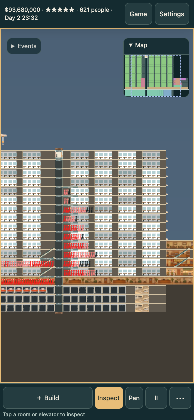

# Three.js browser presentation

The default browser presentation uses Three.js for world drawing and DOM controls for every in-game panel. Native builds retain SDL. The existing C simulation, building rules and save layout remain authoritative; the browser consumes read-only world snapshots and semantic commands documented in [three-api.md](three-api.md).

The orthographic scene uses source-resolution room, person, transport and effect crops, smooth filtering and a DPR-sized render buffer. Interior source aspect ratios are preserved: narrow footprints crop centrally; long rooms repeat the source horizontally. Concrete edges have real shallow geometry. Camera-dependent tilt, distant city and cloud layers provide restrained parallax during pan and zoom. Grid picking intersects the actual camera plane, including its tilt; zoom preserves the pointer's world anchor.

Settings switches four existing styles inside the current simulation. Warm dollhouse is the initial browser preference. State lighting, construction, people, queues, moving cabins, stairs, trains, parking, fire, rescue, ceremony and find markers come from the C snapshot. Weather and map overlays use current simulation state. The compact Build/Inspect/Pan toolbar previews an affordable native construction plan with exact new footprints, skipped spans and price. Build commits that stored plan; Cancel changes nothing. A compact navigable minimap shows actual rooms, shafts, cabins and viewport.

Every native menu group is represented by DOM. The inspector, finance, analytics, tuning, pricing, finding, elevators, names, movies and decisions are structured panels. Audio uses the Web Audio API and original procedural synthesis for the 52 semantic sound IDs, including managed fire/build loops, category volume, mute and background-tab suspension. No image generation or external AI service is involved in this migration.

## Build and verify

Requires Bun, Emscripten, Python and uv. Dependencies are pinned by `bun.lock`.

```sh
bun install --frozen-lockfile
make web
python3 -m http.server 8620 --directory web/dist
node tests/three/verify.cjs http://localhost:8620/
clang -std=c11 -Isrc tests/test_three.c src/tower.c src/game.c src/twr.c src/sound_hook.c -lm -o /tmp/test-three
/tmp/test-three
```

The verification command uses the installed ordinary Chrome through `agent-browser` in its own headless session. It exercises construction, non-mutating full-span preview, all four style swaps, rent/inspection, finance, zoom anchor, capture, IndexedDB persistence and a 390×844 DPR-3 viewport. Output evidence is written under `/tmp`. The service worker precaches a build-generated file manifest, including the bundled Three module, audio and full-resolution crops; no CDN is required at runtime.

## Asset provenance

`tools/prepare_web_art.py` deterministically crops the existing `data/styles/*/sources/` plates. It does not generate or upscale images. The crop manifests record the source hashes and bounds. The only alpha processing follows the existing pack pipeline: connected white edge background is removed while enclosed details remain. Existing source provenance and its historical model/cost records remain untouched.

Production distribution combines this default game with the landing page in the site integration pipeline. The engine repository builds an artifact; it does not deploy a separate competing game site. The browser now requires WebGL2. Source poses now share a registered foot baseline and world body box; painted detail still limits fidelity; a scene uses flat illustrated interiors with shallow geometric structure, not a fully modeled freely navigable 3D tower. Construction remains on the original tower grid.

Actor root causes, source registration, queue semantics and visual cases are documented in [three-actors.md](three-actors.md).

## Validation evidence

The browser smoke passed 21 assertions: sandbox tools, empty and nonempty saves,
non-mutating preview, planned placement, inspection/rent, all four style swaps,
anchored zoom, PNG capture, finance, IndexedDB sync, a 390×844 DPR-3 viewport,
offline restore and full-resolution style switching.

`tests/test_three.c` passed the existing office construction/move-in/overnight/
move-out/rent rescue/re-let lifecycle and 18 lift cases: standard and express,
1/20/100 floors, empty/half/full. Samples stay within the route, accelerate and
brake, reach the exact stop, then open doors and unboard. A separate regression
asserts that a fresh call cannot change the physical position mid-segment.

Independent browser verification used a seeded synthetic tower and real saved
simulation states. Occupied-middle/edge drag, reversed endpoints, unchanged
Cancel and exact-price Build were observed. A limited $85,000 budget selected only two $40,000 offices and retained $5,000; campaign locks matched native catalog availability. A stored $280,000 plan was rejected without construction or further charges after a separate legal $80,000 car purchase left $220,000. The same office ID demonstrated
state 7 vacancy → state 3 re-let; state 5 overnight retained its lease with zero
workers. Completed construction's `-1` sentinel is treated as complete. The
mature scene includes real mixed queue wait bands, full cabins, parking bays,
parked cars, stairs/escalators and the shaft/cabin minimap. Four live styles were
captured at the same paused actor IDs and zoom.



Screenshots show the working browser game at 1600×1000 and 390×844. They are
synthetic gameplay, not generated illustrations. The source runtime is
`e5cef55b5f29f2914d4c01cdeaa686144d30ad34`; subsequent documentation/image changes
do not alter its runtime sources. Native saves retain their layout and the
browser retains `/persist` IDBFS and `ct-slot`, `ct-style`, `ct-zoom`,
`ct-uiscale`. Combined landing/game service-worker migration is verified by the
site delivery owner before publication.

A mobile viewport emulation establishes layout, not physical iPhone performance.
The simulation has no authoritative non-elevator service-queue location/clock;
no such queue is invented from room population or destination state. Original
source paintings still limit fine pose anatomy. This scoped check does not
claim a full simulation audit.
